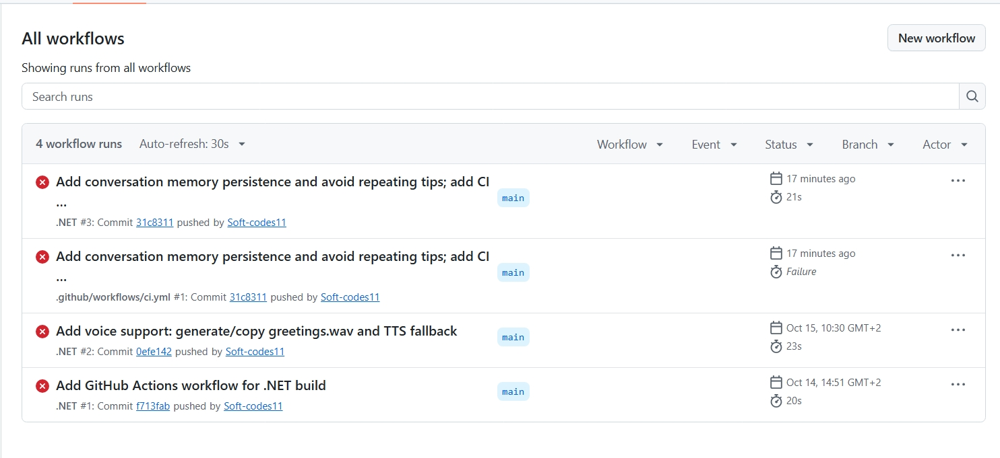

# Cybersecurity Awareness Bot (Part 1)

This repository contains Part 1 of the Cybersecurity Awareness Bot project.

Requirements
- .NET 9 SDK
- C# 13

How to run locally
1. Ensure `Assets/greetings.wav` exists in the repository at `Assets/greetings.wav`.
2. Ensure the WAV file is set to copy to output (project is configured to copy Assets by wildcard).
3. From repository root:
   - dotnet restore
   - dotnet build
   - dotnet run --project "PROG6221 ALL PARTS/PROG6221 ALL PARTS/CybersecurityAwarenessBot.csproj"

Project files updated for Part 1
- `VoiceGreeting.cs` – robust playback, runtime WAV generation fallback, and TTS fallback on Windows.
- `ConsoleUI.cs` – improved prompt, colored output, and typing effect.
- `ResponseManager.cs` – keyword matching, memory-aware responses, and non-repeating tips.
- `ChatBot.cs`, `Program.cs` – improved flow and UX; ChatMemory persistence.

CI
- GitHub Actions workflow located at `.github/workflows/ci.yml` (Windows/.NET). Ensure the workflow is passing on GitHub; a local build has succeeded.

Commit summary
- Total commits in this repository: 35
- Example meaningful commits (at least six):
  - b1cc18d 2026-09-08 Add .gitignore file for Visual Studio project
  - df2accb 2026-09-08 Add voice greeting and multimedia assets
  - 805433f 2026-09-09 Added ggitignore and pre-push checklist; verify voice greeting and UI typing fix
  - f713fab 2026-10-14 Add GitHub Actions workflow for .NET build
  - 0efe142 2026-10-15 Add voice support: generate/copy greetings.wav and TTS fallback
  - 31c8311 2026-10-16 Add conversation memory persistence and avoid repeating tips; add CI workflow

Submission checklist (Part 1)
- [x] Minimum 6 meaningful commits (repository contains more than six commits; key commits listed above)
- [x] GitHub Actions CI configured (workflow file present at `.github/workflows/ci.yml`)
- [x] `Assets/greetings.wav` included or generated at runtime and copied to output by the project
- [ ] README contains run instructions and CI screenshot (add CI screenshot after a successful GitHub run)
- [ ] Unlisted YouTube video walkthrough (include link in README)

# Cybersecurity Awareness Bot (PROG6221 – POE Part 2)

A WPF desktop chatbot that teaches South African users how to stay safe online.
Part 2 converts the Part 1 console app into a GUI and adds keyword recognition,
random responses, conversation flow, memory, and sentiment detection.

**Video presentation:** https://youtu.be/CMbP2Pfxcs4

## How to run

1. Install the [.NET 8 SDK](https://dotnet.microsoft.com/download) (Windows 10/11).
2. Make sure your voice greeting is at `Assets/greetings.wav`.
3. Clone the repo, then in the project folder run:
   
   dotnet run
   
   or open `CybersecurityAwarenessBotUI.csproj` in Visual Studio 2022 and SET IT AS STARTUP PROJECTpress **F5**.

## Features (mapped to the Part 2 brief)

| Requirement | Where / how |
|---|---|
| GUI with all Part 1 features | `MainWindow.xaml` – voice greeting on launch, ASCII logo on the welcome screen and a compact shield in the sidebar, name entry, coloured chat bubbles, typing effect |
| Keyword recognition | `Data/KnowledgeBase.cs` + `Models/Topic.cs` – 8 topics (passwords, phishing/scams, privacy, safe browsing, malware, social engineering, account security, software updates); regex word-start matching with scoring |
| Random responses | Every topic has 4–5 tips dealt from a shuffled deck (`ChatEngine.NextFromDeck`), so tips don't repeat until all have been used |
| Conversation flow | Follow-ups like *"give me another tip"*, *"tell me more"*, *"explain more"*, *"I don't understand"* continue the current topic |
| Memory and recall | `Models/User.cs` stores name, favourite topic, last mood and topics explored. Shown in the sidebar and used to personalise replies. Try *"I'm interested in privacy"* then *"what do you remember about me?"* |
| Sentiment detection | `Services/SentimentAnalyzer.cs` – worried, frustrated, overwhelmed, confused, curious, positive. The bot opens with empathy **and immediately shares a tip** |
| Error handling | Empty input, unknown input, invalid names, audio failures and unexpected exceptions are all handled without crashing |
| Code optimisation | Dictionaries (topics, sentiments), lists, `Queue<int>` decks, **delegates** (`IntentHandler` pipeline, `Action<User>` event), separate classes by responsibility |

## Project structure

CybersecurityAwarenessBot/
├── App.xaml / App.xaml.cs        Application entry point + global error handler + styles
├── MainWindow.xaml / .cs         GUI only (no chatbot logic)
├── Models/                       User (memory), Topic, Sentiment, ChatReply, ChatMessage
├── Services/
│   ├── ChatEngine.cs             Delegate pipeline: memory → recall → small talk → topics/sentiment
│   ├── SentimentAnalyzer.cs      Mood detection + empathetic openers
│   └── VoiceGreeting.cs          Plays Assets/greetings.wav on a background thread
├── Data/KnowledgeBase.cs         All topics, tips, details, sentiment keywords
├── Helpers/AsciiArt.cs           ASCII logo from Part 1
├── Assets/greetings.wav          Voice greeting
└── .github/workflows/dotnet.yml  CI: restore + build on every push

## Example conversation

You:     Hi
CyberBot: Hello, Sam! Ready to learn something new about staying safe online?
You:     I'm interested in privacy
CyberBot: Great! I'll remember that you're interested in privacy. ...
You:     I'm worried about online scams
CyberBot: It's completely understandable to feel that way, Sam. ... [phishing tip]
You:     tell me more
CyberBot: [deeper explanation on phishing]
You:     give me another tip
CyberBot: [a different phishing tip]

## Releases

- **v1.0.0** – Part 1 console chatbot
- **v1.1.0** – WPF GUI conversion
- **v2.0.0** – Part 2 complete (keywords, random replies, memory, sentiment)

## References

- Microsoft. 2026. *Windows Presentation Foundation documentation*. [Online]. Available at: https://learn.microsoft.com/en-us/dotnet/desktop/wpf/ [Accessed 11 October 2026].
- Pieterse, H. 2021. The Cyber Threat Landscape in South Africa: A 10-Year Review. *The African Journal of Information and Communication*, 28(28). doi: https://doi.org/10.23962/10539/32213.
- Republic of South Africa. 2013. *Protection of Personal Information Act 4 of 2013*. Pretoria: Government Printer.
  
## CI: Successful Run

